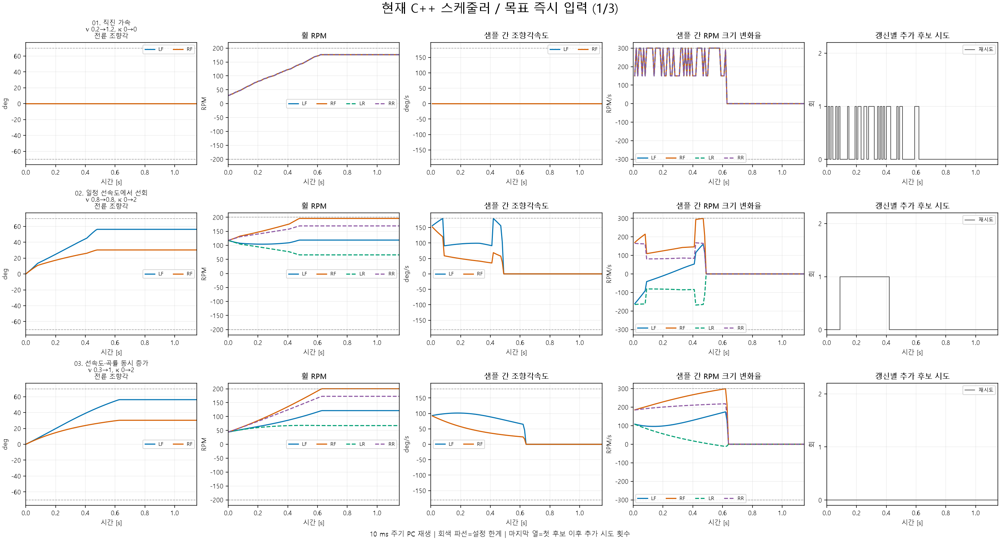
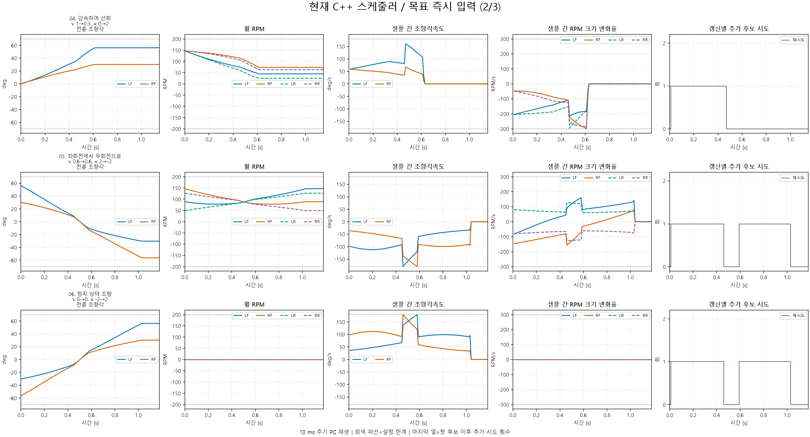
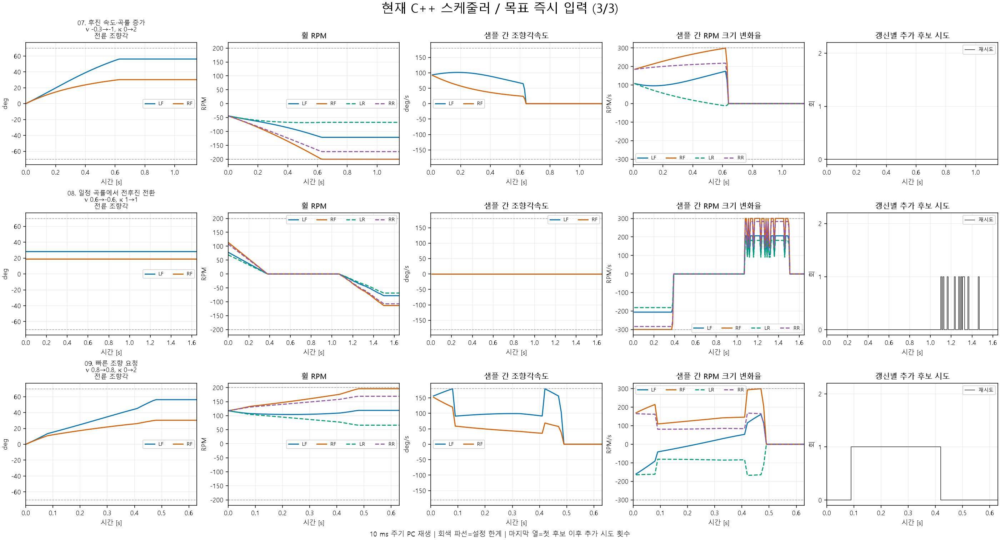
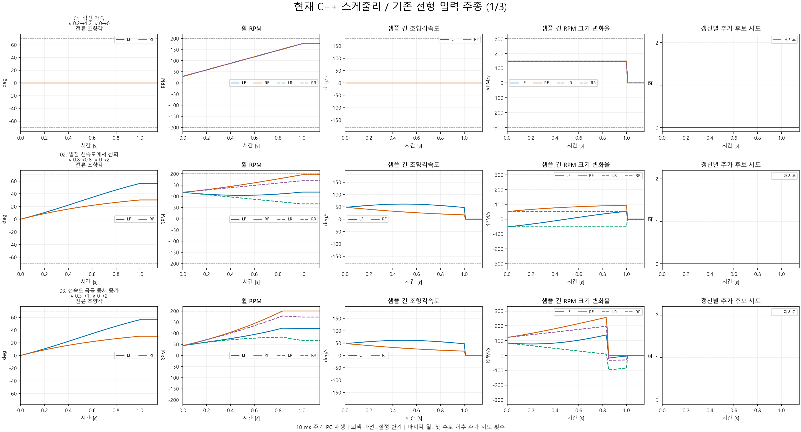
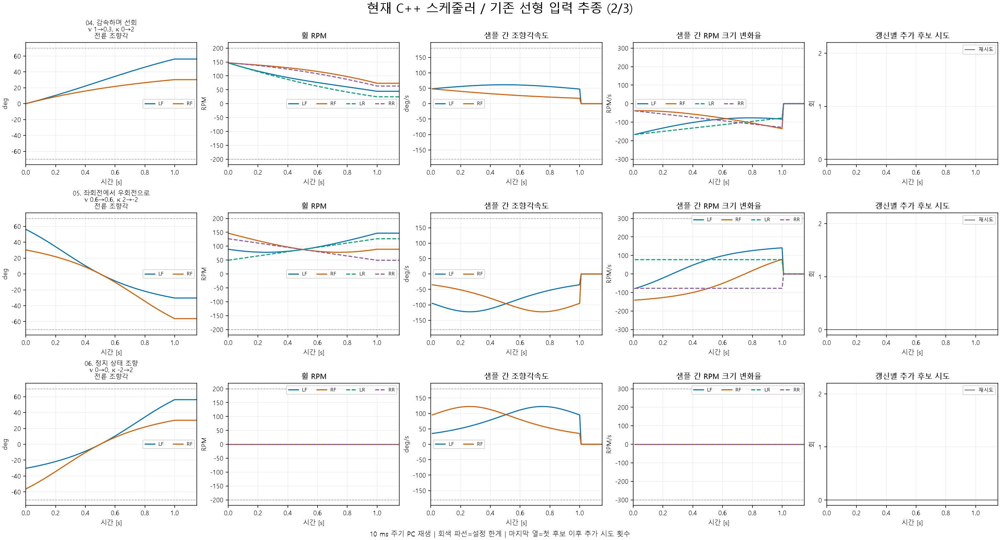
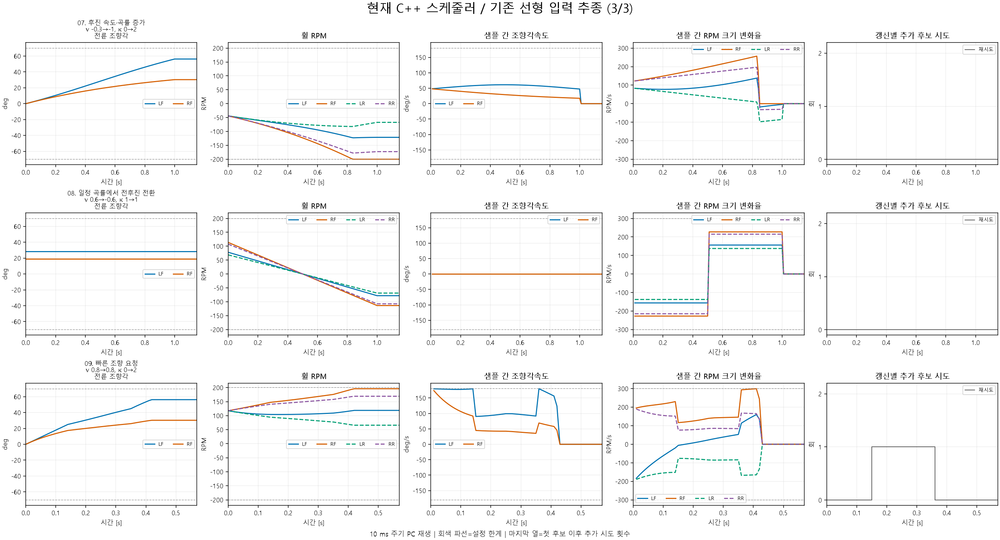

# 현재 MCU 스케줄러: 9가지 시나리오 비교

2026-11-15. 실제 `include/vehicle_motion.hpp`를 PC에서 컴파일해 호출한 오프라인 결과이다.

## 조건과 범위

- RPM 크기 증가율 300RPM/s, 감소율 300RPM/s, RPM 상한 200, 조향각속도 한계 180도/s.
- 10ms 고정 갱신. 초기 명령을 10초간 유지해 DRIVING에 도달한 뒤, 전환 구간 5초를 기록했다. 초기 기동 대기는 그래프에서 제외했다.
- step: t=0 초기 상태를 기록하고 첫 10ms 갱신부터 최종 목표를 유지한다. MCU 자체에는 1초 전환시간 인자가 없다.
- ramp: 이전 실험과 동일하게 v, κ 요청을 1초(9번은 0.25초) 동안 선형 변경하고 이후 최종 목표를 유지한다.
- 조향각·RPM은 생성 지령이다. CAN 정수화·전송 간격, PWM 프레임, 모터 지연·부하·측정값은 포함하지 않았다.
- 원본 헤더 실행 결과와 계측 복사본의 모든 출력·상태를 18개 실행 전체에서 동일하게 확인했다. 원본 펌웨어 파일은 수정하지 않았다.
- float 연산은 PC g++에서 SSE(-msse2 -mfpmath=sse -ffp-contract=off)로 수행했다. 기본 32비트 MinGW의 x87 확장 정밀도 영향을 피했다. Teensy의 최종 비트 패턴이나 실행시간/WCET를 검증한 결과가 아니다.
- 변화율은 인접 출력의 차이/0.01초이다. 이전 그림의 해석적 순간 변화율과는 정의가 다르다. 아주 작은 차이는 float와 CSV 반올림에서 생길 수 있다.
- 생성 v는 후륜 RPM 평균, 생성 κ는 좌측 전륜 각도에서 역산했다. private scheduled 변수를 변경하지 않았다.
- 도달 시간은 최종 출력 대비 RPM 1e-4, 조향각 1e-5도 이내에 이후 계속 머무는 첫 샘플이다. 곡률이 주어졌을 때 RPM 상한으로 낮아진 최종 속도를 포함한다.

## 재연산 횟수의 의미

- 후보 시도 수: `advance_drive()`의 실제 반복 횟수, 최대 12회.
- 추가 재시도 수: 후보 시도 수 - 1. 첫 후보 거부 후 fraction을 절반으로 줄여 다시 시도한 횟수, 최대 11회.
- evaluate 횟수: 목표 계산 1회와 실제 중간 후보 운동학 계산을 포함한다. 첫 후보가 목표 자체인 경우는 목표 계산을 재사용한다.
- 모든 후보가 거부되면 이전 지령 전체를 유지한다. 이 횟수는 failed_search_updates에 기록했다.
- BRAKING/STEERING/SETTLING 갱신은 이 후보 탐색을 수행하지 않을 수 있다. 재시도 0은 반드시 DRIVING이었다는 뜻이 아니다.
- 표의 재시도 갱신 수/히스토그램은 전환 완료까지의 DRIVING 탐색 갱신만 집계한다. 완료 후 유지 구간을 분모에 넣지 않았다. 최대값·탐색 실패 횟수는 전체 5초 기준이다.

## 전체 비교

| 예시 | 입력 | 도달 [s] | 최종 v | 최대 RPM | 최대 조향속도 | 최대 RPM 증가율 | 최대 추가 시도 | 재시도 갱신/탐색 갱신 | 탐색 실패 |
|---|---|---:|---:|---:|---:|---:|---:|---:|---:|
| 직진 가속 | step | 0.62 | 1.2000 | 176.29 | 0.00 | 300.00 | 1 | 26/62 | 0 |
| 직진 가속 | ramp | 1.00 | 1.2000 | 176.29 | 0.00 | 146.91 | 0 | 0/100 | 0 |
| 일정 선속도에서 선회 | step | 0.48 | 0.8000 | 195.83 | 179.47 | 299.35 | 1 | 33/48 | 0 |
| 일정 선속도에서 선회 | ramp | 1.00 | 0.8000 | 195.83 | 61.27 | 94.24 | 0 | 0/100 | 0 |
| 선속도·곡률 동시 증가 | step | 0.63 | 0.8170 | 200.00 | 101.31 | 299.08 | 0 | 0/63 | 0 |
| 선속도·곡률 동시 증가 | ramp | 1.00 | 0.8170 | 200.00 | 61.27 | 256.71 | 0 | 0/100 | 0 |
| 감속하며 선회 | step | 0.62 | 0.3000 | 146.91 | 160.81 | 0.00 | 1 | 46/62 | 0 |
| 감속하며 선회 | ramp | 1.00 | 0.3000 | 146.91 | 61.27 | 0.00 | 0 | 0/100 | 0 |
| 좌회전에서 우회전으로 | step | 1.03 | 0.6000 | 146.87 | 179.23 | 159.88 | 1 | 89/103 | 0 |
| 좌회전에서 우회전으로 | ramp | 1.00 | 0.6000 | 146.87 | 122.54 | 141.22 | 0 | 0/100 | 0 |
| 정지 상태 조향 | step | 1.03 | 0.0000 | 0.00 | 179.23 | 0.00 | 1 | 89/103 | 0 |
| 정지 상태 조향 | ramp | 1.00 | 0.0000 | 0.00 | 122.54 | 0.00 | 0 | 0/100 | 0 |
| 후진 속도·곡률 증가 | step | 0.63 | -0.8170 | 200.00 | 101.31 | 299.08 | 0 | 0/63 | 0 |
| 후진 속도·곡률 증가 | ramp | 1.00 | -0.8170 | 200.00 | 61.27 | 256.71 | 0 | 0/100 | 0 |
| 일정 곡률에서 전후진 전환 | step | 1.50 | -0.6000 | 113.69 | 0.00 | 300.00 | 1 | 10/43 | 0 |
| 일정 곡률에서 전후진 전환 | ramp | 1.00 | -0.6000 | 113.69 | 0.00 | 227.39 | 0 | 0/100 | 0 |
| 빠른 조향 요청 | step | 0.48 | 0.8000 | 195.83 | 179.47 | 299.35 | 1 | 33/48 | 0 |
| 빠른 조향 요청 | ramp | 0.42 | 0.8000 | 195.83 | 179.97 | 299.22 | 1 | 21/42 | 0 |

## 주요 관찰

- 이번 18개 조건에서는 추가 후보 시도 최대 1회(총 후보 2회), evaluate 최대 3회였다. 탐색 소진 후 유지한 갱신은 0회다. 다른 입력·주기에서의 최악 횟수나 MCU 실행시간을 보장하는 결과는 아니다.
- 3·7번 step의 최종 속도 크기는 각각 0.817028, 0.817028m/s다. 목표 RPM 공통 축소와 초기 fraction 계산은 추가 재시도에 포함되지 않는다. 재시도 0회가 제한을 적용하지 않았다는 뜻은 아니다.
- 9번 ramp 입력은 0.25초에 끝나며 생성 지령은 0.42초에 도달한다. step은 전환시간을 받지 않으므로 2번과 9번은 동일한 입력이다.
- 8번의 관측 상태: step `DRIVING → BRAKING → SETTLING → DRIVING`, ramp `DRIVING`. STEERING처럼 같은 update 안에서 진입·탈출한 상태는 CSV 종료 상태에 따로 나타나지 않을 수 있다.
- 재시도가 있는 구간은 진행량을 절반으로 줄이므로 변화율이 매끄럽지 않거나 보수적으로 낮아질 수 있다. 6번 정지 조향의 도달 시간은 step 1.03초, ramp 1.00초다.
- 기록된 RPM 크기 변화율의 한계 초과 최대치는 4.8e-05RPM/s다. float 시간 간격·출력 산술·CSV 표현에 따른 미세 차이도 포함한다.

## 비교 그림








## 상세 그림과 데이터

- 직진 가속: [상세 PNG](01_straight_acceleration_comparison.png) · [SVG](01_straight_acceleration_comparison.svg) · [step CSV](01_straight_acceleration_step.csv) · [ramp CSV](01_straight_acceleration_ramp.csv)
- 일정 선속도에서 선회: [상세 PNG](02_constant_speed_turn_comparison.png) · [SVG](02_constant_speed_turn_comparison.svg) · [step CSV](02_constant_speed_turn_step.csv) · [ramp CSV](02_constant_speed_turn_ramp.csv)
- 선속도·곡률 동시 증가: [상세 PNG](03_speed_and_curvature_comparison.png) · [SVG](03_speed_and_curvature_comparison.svg) · [step CSV](03_speed_and_curvature_step.csv) · [ramp CSV](03_speed_and_curvature_ramp.csv)
- 감속하며 선회: [상세 PNG](04_slowdown_into_turn_comparison.png) · [SVG](04_slowdown_into_turn_comparison.svg) · [step CSV](04_slowdown_into_turn_step.csv) · [ramp CSV](04_slowdown_into_turn_ramp.csv)
- 좌회전에서 우회전으로: [상세 PNG](05_left_to_right_comparison.png) · [SVG](05_left_to_right_comparison.svg) · [step CSV](05_left_to_right_step.csv) · [ramp CSV](05_left_to_right_ramp.csv)
- 정지 상태 조향: [상세 PNG](06_stationary_steering_comparison.png) · [SVG](06_stationary_steering_comparison.svg) · [step CSV](06_stationary_steering_step.csv) · [ramp CSV](06_stationary_steering_ramp.csv)
- 후진 속도·곡률 증가: [상세 PNG](07_reverse_acceleration_comparison.png) · [SVG](07_reverse_acceleration_comparison.svg) · [step CSV](07_reverse_acceleration_step.csv) · [ramp CSV](07_reverse_acceleration_ramp.csv)
- 일정 곡률에서 전후진 전환: [상세 PNG](08_direction_reversal_comparison.png) · [SVG](08_direction_reversal_comparison.svg) · [step CSV](08_direction_reversal_step.csv) · [ramp CSV](08_direction_reversal_ramp.csv)
- 빠른 조향 요청: [상세 PNG](09_fast_steering_comparison.png) · [SVG](09_fast_steering_comparison.svg) · [step CSV](09_fast_steering_step.csv) · [ramp CSV](09_fast_steering_ramp.csv)

## 재시도 분포와 상태 변화

분포는 `추가 시도 횟수: 갱신 개수`이다.

- 직진 가속 / step: `{'0': 36, '1': 26}`, 상태 `DRIVING`, evaluate 최대 3회.
- 직진 가속 / ramp: `{'0': 100}`, 상태 `DRIVING`, evaluate 최대 1회.
- 일정 선속도에서 선회 / step: `{'0': 15, '1': 33}`, 상태 `DRIVING`, evaluate 최대 3회.
- 일정 선속도에서 선회 / ramp: `{'0': 100}`, 상태 `DRIVING`, evaluate 최대 1회.
- 선속도·곡률 동시 증가 / step: `{'0': 63}`, 상태 `DRIVING`, evaluate 최대 2회.
- 선속도·곡률 동시 증가 / ramp: `{'0': 100}`, 상태 `DRIVING`, evaluate 최대 1회.
- 감속하며 선회 / step: `{'0': 16, '1': 46}`, 상태 `DRIVING`, evaluate 최대 3회.
- 감속하며 선회 / ramp: `{'0': 100}`, 상태 `DRIVING`, evaluate 최대 1회.
- 좌회전에서 우회전으로 / step: `{'0': 14, '1': 89}`, 상태 `DRIVING`, evaluate 최대 3회.
- 좌회전에서 우회전으로 / ramp: `{'0': 100}`, 상태 `DRIVING`, evaluate 최대 1회.
- 정지 상태 조향 / step: `{'0': 14, '1': 89}`, 상태 `DRIVING`, evaluate 최대 3회.
- 정지 상태 조향 / ramp: `{'0': 100}`, 상태 `DRIVING`, evaluate 최대 1회.
- 후진 속도·곡률 증가 / step: `{'0': 63}`, 상태 `DRIVING`, evaluate 최대 2회.
- 후진 속도·곡률 증가 / ramp: `{'0': 100}`, 상태 `DRIVING`, evaluate 최대 1회.
- 일정 곡률에서 전후진 전환 / step: `{'0': 33, '1': 10}`, 상태 `DRIVING → BRAKING → SETTLING → DRIVING`, evaluate 최대 3회.
- 일정 곡률에서 전후진 전환 / ramp: `{'0': 100}`, 상태 `DRIVING`, evaluate 최대 1회.
- 빠른 조향 요청 / step: `{'0': 15, '1': 33}`, 상태 `DRIVING`, evaluate 최대 3회.
- 빠른 조향 요청 / ramp: `{'0': 21, '1': 21}`, 상태 `DRIVING`, evaluate 최대 3회.

[요약 CSV](summary.csv) · [상세 수치·소스 해시 JSON](summary.json)

재실행 (저장소 루트):

```powershell
uv run --no-project --with numpy --with matplotlib python analysis/linear_motion_schedule/compare_controller.py
```
