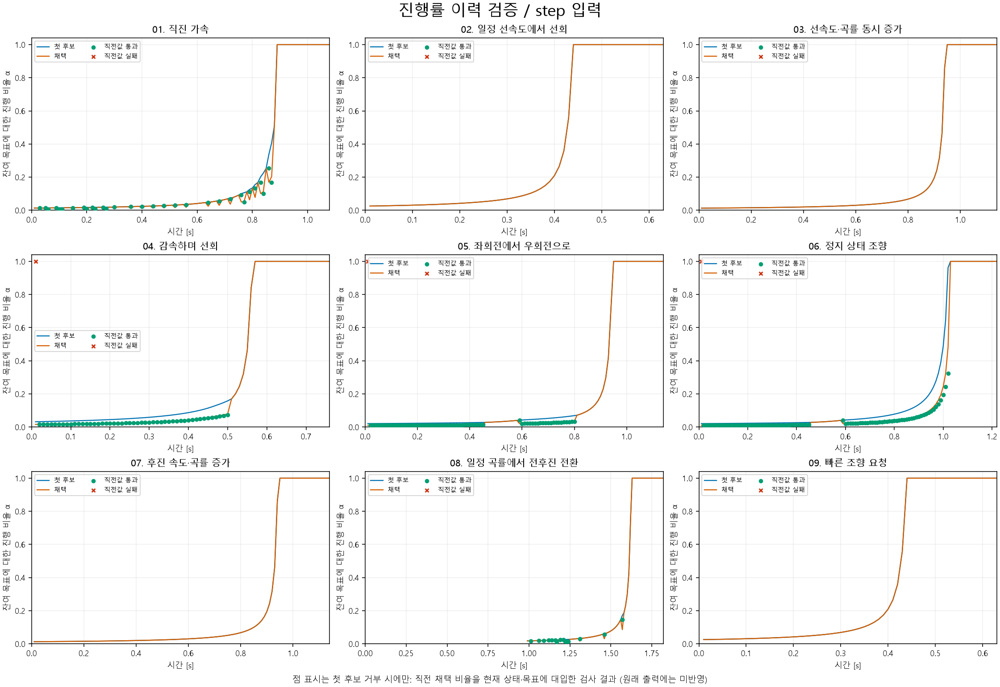
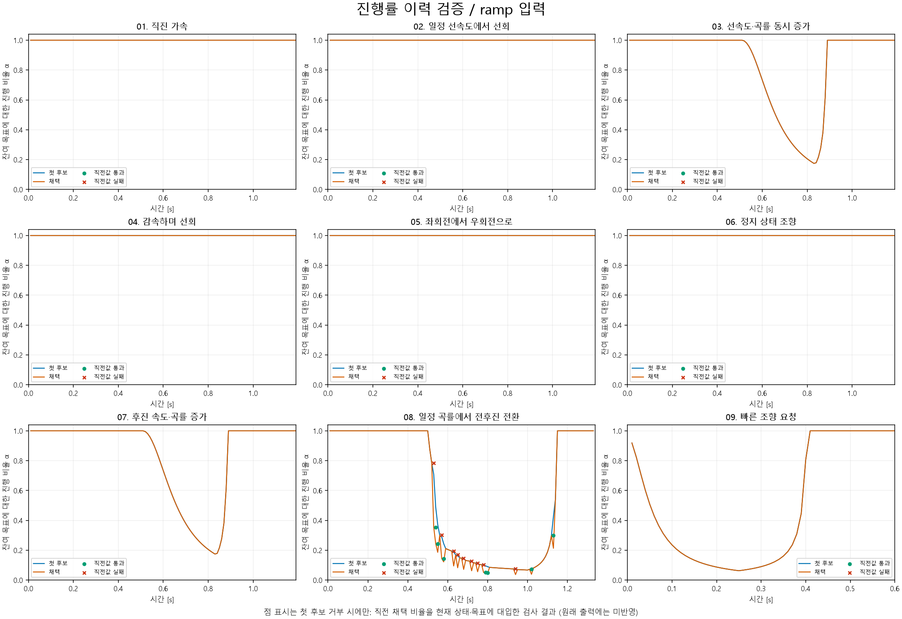

# 진행률 이력 재사용 검증

2026-11-15. 기존 9개 시나리오 × step/ramp, 10ms 갱신, 각 5초 관측.

## 검사 정의

- 첫 후보 진행률 α_initial, 실제 채택 진행률 α_accepted를 각각 기록했다.
- 첫 후보 거부가 발생하면 현재 α_initial을 (A) 직전 α_accepted, (B) 직전 α_initial과 각각 비교했다.
- 동일한 갱신 직전 controller 복사본에서, 현재 요청에 직전 α_accepted 또는 직전 α_initial을 대입하고 원래 evaluate/step_allowed로 검사했다.
- α를 제외한 현재 상태·요청·dt·RPM 목표 제한은 그대로다. 성공은 해당 후보가 현재 코드의 전체 검사를 통과한다는 뜻이다.
- 이 대안은 채택하지 않는다. 장기적으로 이전 비율을 계속 사용하는 정책을 실행한 실험이 아니라, 기존 출력 경로에서 한 갱신씩 대안을 검사한 결과다.
- 직전 갱신이 후보를 채택하지 않은 경우 재사용 이력 없음으로 취급한다. 첫 갱신의 직전 값은 초기 상태를 유지한 준비 구간의 마지막 채택값(1)이다.
- 증가/동일/감소는 기록된 float 값의 직접 비교다. 제한 비율은 1 초과가 위반을 뜻하나 출력 반올림으로 경계값이 1로 보일 수 있다.
- 원본 C++ 출력·상태와 계측 복사본이 18개 실행 전체에서 동일함을 확인했다. 첫 후보 거부도 복사본 검사에서 다시 거부됨을 확인했다.
- PC g++ SSE float 재생이다. 실제 MCU 실행시간·하드웨어 응답·모든 입력에 대한 보장으로 해석하지 않는다.

## 해석

- 첫 후보 거부 268개 중 직전 채택 비율 재사용은 256개 통과, 12개 실패했다.
- 이번 조건에서는 직전 채택 비율보다 새 첫 후보 비율이 증가한 거부 256개에서 재사용이 모두 통과했다. 비율이 감소한 거부 12개에서는 모두 실패했다. 인과관계나 일반 보장은 아니다.
- 진행률 증가 자체가 거부를 뜻하지 않는다. 비교 가능한 전체 갱신 중 증가 735개에서는 256개만 거부됐고 479개는 첫 후보가 통과했다. 전체 집계에는 목표 도달 후 유지 갱신도 포함된다.
- 재사용 실패 12개: 4·5·6번 step의 첫 갱신 각 1개(직전 유지 상태의 비율 1을 새 목표에 적용), 8번 ramp의 9개(움직이는 목표로 인해 허용 비율 감소).
- 재사용 통과 256개 중 42개는 기존 반감 후 채택값보다 큰 비율이고, 214개는 오히려 더 작은 비율이다. 통과율이 높아도 최대 진행량이나 전체 응답 개선을 의미하지 않는다.
- 직전 첫 후보 비율과 비교하면 거부 중 증가 251개, 감소 17개다. 직전 첫 후보 비율을 재사용하면 73개만 통과한다. 직전 채택값과 혼동하면 안 된다.
- 비율 α는 물리적인 속도가 아니라 매 갱신의 잔여 목표 차이에 대한 비율이다. 같은 α라도 목표·현재 상태가 바뀌면 실제 변화량이 달라진다.
- 반례: 8번 ramp 0.53초, 새 첫 후보 0.708835185, 직전 채택 0.785024643. 직전값 재사용 시 RPM 변화량/허용량=1.10748541로 약 10.75% 초과한다.
- 개선 가능 예: 1번 step 0.03초, 첫 후보 0.0139946025가 거부되고 0.00699730124 채택. 직전 채택 0.0138014564를 재사용하면 통과하며 기존 채택값보다 더 진행한다.

## 전체 결과

```json
{
  "first_failures": 268,
  "reuse_pass": 256,
  "reuse_fail": 12,
  "unavailable": 0,
  "previous_initial_reuse_pass": 73,
  "failed_vs_previous_accepted": {
    "increased": 256,
    "unchanged": 0,
    "decreased": 12
  },
  "failed_vs_previous_initial": {
    "increased": 251,
    "unchanged": 0,
    "decreased": 17
  },
  "all_vs_previous_accepted": {
    "increased": 735,
    "unchanged": 8033,
    "decreased": 133
  },
  "all_vs_previous_initial": {
    "increased": 721,
    "unchanged": 8033,
    "decreased": 147
  },
  "reused_pass_vs_original_accepted": {
    "larger": 42,
    "equal": 0,
    "smaller": 214
  }
}
```

## 시나리오별 결과

| 예시 | 입력 | 첫 후보 거부 | 직전 채택 대비 증가/동일/감소 | 직전 첫 후보 대비 증가/동일/감소 | 직전 채택 재사용 통과/실패/없음 |
|---|---|---:|---|---|---|
| 직진 가속 | step | 31 | 31/0/0 | 31/0/0 | 31/0/0 |
| 직진 가속 | ramp | 0 | 0/0/0 | 0/0/0 | 0/0/0 |
| 일정 선속도에서 선회 | step | 0 | 0/0/0 | 0/0/0 | 0/0/0 |
| 일정 선속도에서 선회 | ramp | 0 | 0/0/0 | 0/0/0 | 0/0/0 |
| 선속도·곡률 동시 증가 | step | 0 | 0/0/0 | 0/0/0 | 0/0/0 |
| 선속도·곡률 동시 증가 | ramp | 0 | 0/0/0 | 0/0/0 | 0/0/0 |
| 감속하며 선회 | step | 50 | 49/0/1 | 49/0/1 | 49/1/0 |
| 감속하며 선회 | ramp | 0 | 0/0/0 | 0/0/0 | 0/0/0 |
| 좌회전에서 우회전으로 | step | 67 | 66/0/1 | 66/0/1 | 66/1/0 |
| 좌회전에서 우회전으로 | ramp | 0 | 0/0/0 | 0/0/0 | 0/0/0 |
| 정지 상태 조향 | step | 89 | 88/0/1 | 88/0/1 | 88/1/0 |
| 정지 상태 조향 | ramp | 0 | 0/0/0 | 0/0/0 | 0/0/0 |
| 후진 속도·곡률 증가 | step | 0 | 0/0/0 | 0/0/0 | 0/0/0 |
| 후진 속도·곡률 증가 | ramp | 0 | 0/0/0 | 0/0/0 | 0/0/0 |
| 일정 곡률에서 전후진 전환 | step | 15 | 15/0/0 | 15/0/0 | 15/0/0 |
| 일정 곡률에서 전후진 전환 | ramp | 16 | 7/0/9 | 2/0/14 | 7/9/0 |
| 빠른 조향 요청 | step | 0 | 0/0/0 | 0/0/0 | 0/0/0 |
| 빠른 조향 요청 | ramp | 0 | 0/0/0 | 0/0/0 | 0/0/0 |

## 그래프




[거부 갱신 상세 CSV](failure_events.csv) · [요약 JSON](summary.json)

각 시나리오의 전체 시계열은 `<시나리오>_<step 또는 ramp>.csv`이다. reuse_accepted_ok는 통과 1, 실패 0, 미검사 -1이다.

재실행:

```powershell
uv run --no-project --with numpy --with matplotlib python analysis/linear_motion_schedule/check_fraction_history.py
```
