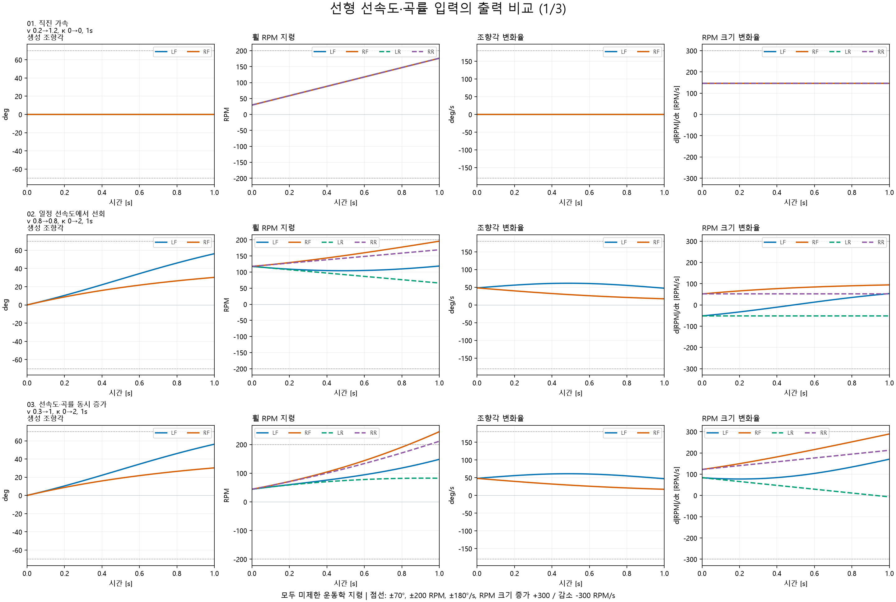
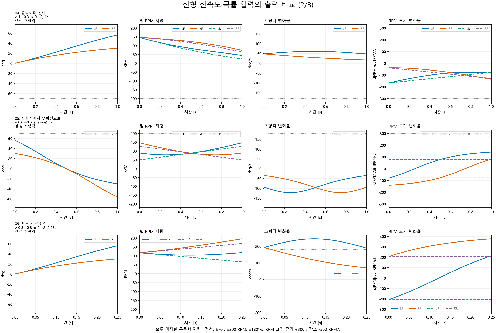
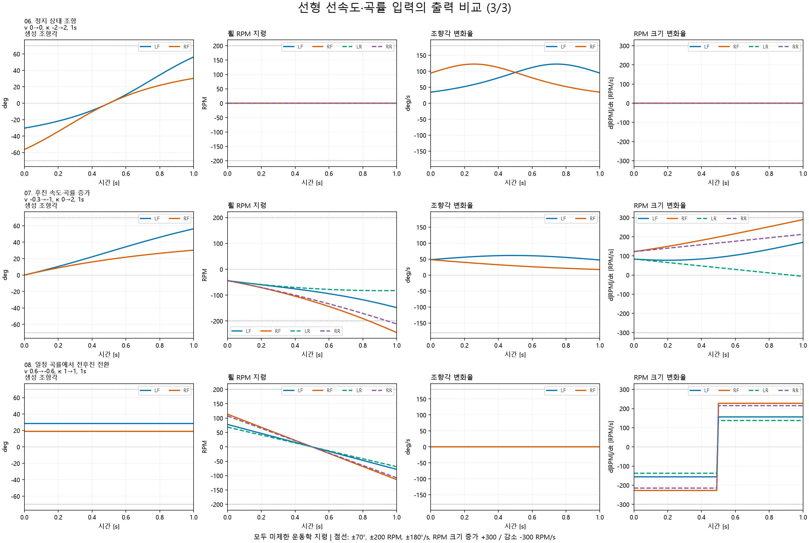

# 선형 선속도·곡률 스케줄 시뮬레이션

2026-11-15. 사용자가 요청한 오프라인 Python 시뮬레이션이다. MCU 코드 실행·통신·업로드는 하지 않는다.

## 모델과 해석

- 후륜 축 중앙 기준의 선속도와 곡률을 시작값에서 목표값까지 시간에 대해 선형 보간한다.
- 저장소 설정을 읽었다: 축거 0.42 m, 전륜 윤거 0.439 m, 후륜 윤거 0.439 m, 휠 반경 0.065 m.
- 일반 MANUAL 운동학을 적용한다. PIVOT, BRAKING/SETTLING, RPM 제한·가감속 제한·조향 변화율 제한은 적용하지 않는다.
- 점선은 현재 펌웨어 설정과 비교하기 위한 기준선이다. 상한 초과값을 숨기거나 클램프하지 않는다.
- 비교 기준: RPM 크기 증가율 300RPM/s, 감소율 300RPM/s, RPM 상한 200.
- 조향각은 보정에서 사용하는 차량 좌우 전륜 각도 지령이다. 실제 서보축 각도·PWM·지연·부하·타이어 미끄러짐을 시뮬레이션한 것이 아니다.
- 1/s가 아니라 곡률 단위는 1/m이다. RPM 변화율 단위는 RPM/s이다.
- 변화율은 운동학 식을 해석적으로 미분했다. 그래프와 요약 최대값은 샘플 지점 값이며, 구간 전체 최대값의 별도 최적화 결과는 아니다.
- 전환 구간 양 끝의 변화율은 구간 안쪽 단측 값이다. 전환 전후의 유지 구간이나 jerk는 포함하지 않는다.
- RPM 크기 변화율 d|RPM|/dt: 양수는 가속, 음수는 감속이다. RPM 0에서는 출발 방향의 단측 값을 사용한다. 전후진 전환의 영점에서는 양측 미분이 정의되지 않는다.
- Δ 조향각·Δ RPM 패널은 인접 샘플의 실제 차이다. CSV 첫 샘플의 Δ는 이전 샘플이 없어 NaN이다.
- 역방향·정지 예시에서도 속도로 나누지 않고 곡률로 조향각을 직접 계산한다.
- 전후진 전환 예시는 순수 수학 스케줄이다. 실제 MCU의 반전 감속·대기 절차를 재현하지 않는다.

## 그림





| 예시 | v [m/s] | κ [1/m] | 시간 [s] | 상세 그림 | 데이터 |
|---|---|---|---:|---|---|
| 직진 가속 | 0.2 → 1.2 | 0 → 0 | 1 | [PNG](01_straight_acceleration.png) / [SVG](01_straight_acceleration.svg) | [CSV](01_straight_acceleration.csv) |
| 일정 선속도에서 선회 | 0.8 → 0.8 | 0 → 2 | 1 | [PNG](02_constant_speed_turn.png) / [SVG](02_constant_speed_turn.svg) | [CSV](02_constant_speed_turn.csv) |
| 선속도·곡률 동시 증가 | 0.3 → 1 | 0 → 2 | 1 | [PNG](03_speed_and_curvature.png) / [SVG](03_speed_and_curvature.svg) | [CSV](03_speed_and_curvature.csv) |
| 감속하며 선회 | 1 → 0.3 | 0 → 2 | 1 | [PNG](04_slowdown_into_turn.png) / [SVG](04_slowdown_into_turn.svg) | [CSV](04_slowdown_into_turn.csv) |
| 좌회전에서 우회전으로 | 0.6 → 0.6 | 2 → -2 | 1 | [PNG](05_left_to_right.png) / [SVG](05_left_to_right.svg) | [CSV](05_left_to_right.csv) |
| 정지 상태 조향 | 0 → 0 | -2 → 2 | 1 | [PNG](06_stationary_steering.png) / [SVG](06_stationary_steering.svg) | [CSV](06_stationary_steering.csv) |
| 후진 속도·곡률 증가 | -0.3 → -1 | 0 → 2 | 1 | [PNG](07_reverse_acceleration.png) / [SVG](07_reverse_acceleration.svg) | [CSV](07_reverse_acceleration.csv) |
| 일정 곡률에서 전후진 전환 | 0.6 → -0.6 | 1 → 1 | 1 | [PNG](08_direction_reversal.png) / [SVG](08_direction_reversal.svg) | [CSV](08_direction_reversal.csv) |
| 빠른 조향 요청 | 0.8 → 0.8 | 0 → 2 | 0.25 | [PNG](09_fast_steering.png) / [SVG](09_fast_steering.svg) | [CSV](09_fast_steering.csv) |

[요약 수치 CSV](summary.csv) · [설정·소스 해시·휠별 상세 JSON](summary.json)

## 다시 실행

저장소 루트에서:

```powershell
uv run --no-project --with numpy --with matplotlib python analysis/linear_motion_schedule/simulate.py
# 사용자 지정: v0 v1 k0 k1 전환시간(초)
uv run --no-project --with numpy --with matplotlib python analysis/linear_motion_schedule/simulate.py --custom 0.3 1.0 0 2 1 --output analysis/linear_motion_schedule/custom_output
```

외부 plotting 의존성은 uv 임시 환경을 사용하며 저장소 pyproject.toml·uv.lock을 변경하지 않는다.
