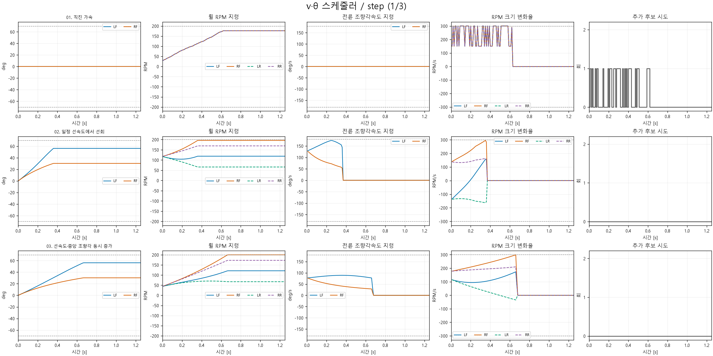
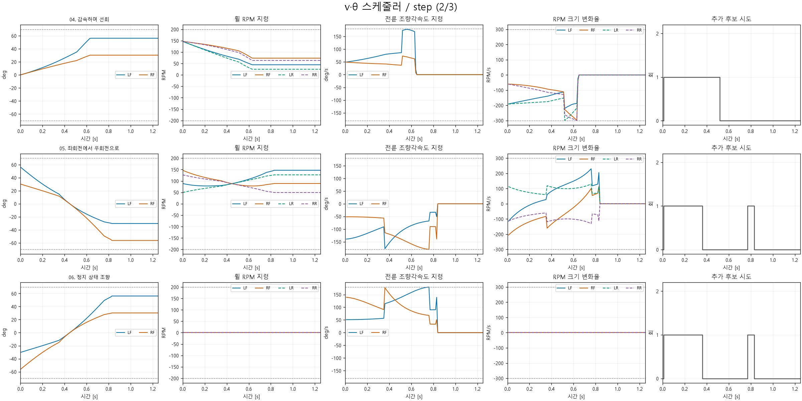
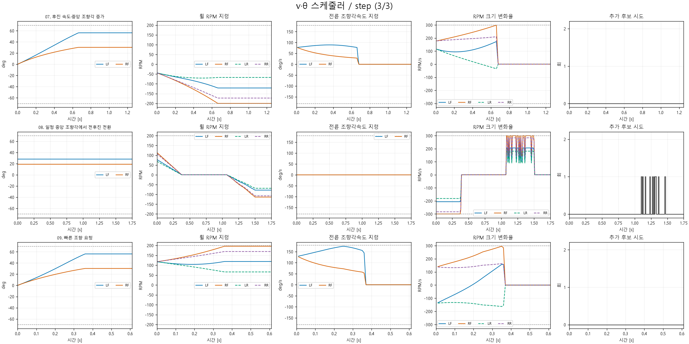
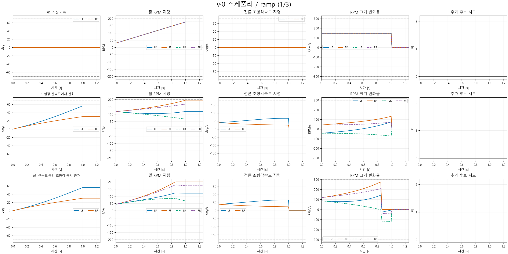
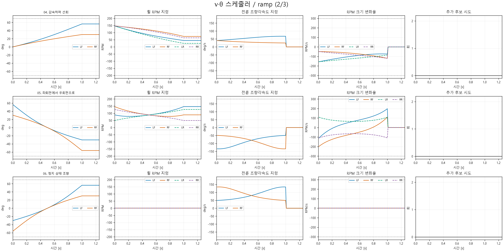
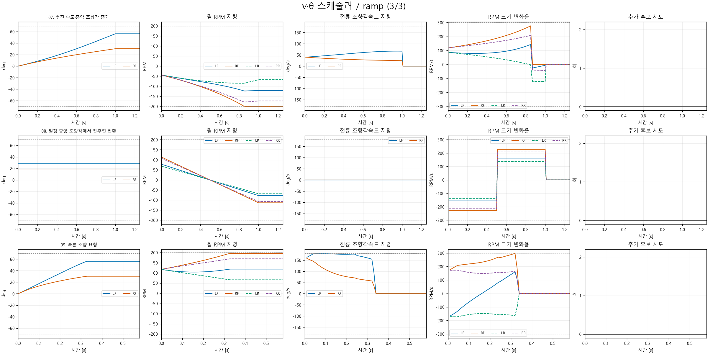

# v·θ 스케줄러의 step·ramp 응답

실행일: 2026-11-16

현재 C++ 모션 헤더를 PC에서 직접 호출한 9개 시나리오 × 2개 입력 방식, 총 18개 실행이다.
기존 실험의 시작·목표 곡률만 θ=atan(Lκ)로 환산했다. ramp 중간 경로는 v·θ에 선형이므로 이전 v·κ ramp와 다르다.
초기 명령 10초 유지 후 DRIVING부터 10ms 간격으로 5초 기록했다. step은 첫 10ms 갱신부터 최종 목표를 준다.
ramp는 1초(9번은 0.25초) 동안 v·θ를 선형 변경한다. RC 필터·PWM 입력·노이즈는 포함하지 않는다.
선속도·중앙각 생성값은 후륜 RPM 평균·좌측 전륜 지령각에서 역산한다. private 상태는 변경하지 않는다.
조향각과 RPM은 생성 지령이며 서보·구동기 동역학, 실제 추종 지연, CAN 전송, 정수화는 포함하지 않는다.
원본 헤더와 계측 복사본의 첫 16개 출력 열이 전체 실행에서 일치했다. 계측은 카운터만 추가한다.
PC float 연산에 SSE 옵션을 사용했다. Teensy 빌드·실물 주행·MCU 실행시간 검증은 아니다.

## 지표 정의

- 도달: 별도로 계산한 최종 목표(200RPM 공통 상한 적용)와 모든 조향각 1e-4도, RPM 1e-3 이내에 이후 계속 머무는 첫 시각. 5초 안에 도달하지 않으면 null.
- 변화율: 인접 지령 차이/0.01초. RPM은 크기의 차분이다. float·CSV 표현에 의한 미세한 한계 초과가 포함될 수 있다.
- 재시도: 첫 후보 이후 추가 후보 수(max(attempts-1,0)). evaluate는 최종 목표와 중간 후보 운동학 호출 수다.
- 재시도 분포는 도달 또는 ramp 종료 중 늦은 시점까지의 탐색 갱신을 집계한다. 최대값·실패 수는 5초 전체다.
- 탐색 실패: 후보 탐색을 했으나 채택하지 못해 이전 출력을 유지한 갱신. 상태 그래프는 update 종료 시점의 펌웨어 enum이며 DRIVING도 RPM 0일 수 있다.
- 기존 곡률 실험의 도달 기준은 마지막 출력 기준으로 달랐으므로 도달 시간을 그대로 같은 지표로 비교하지 않는다.

## 결과

| 사례 | 입력 | 도달(s) | 최종 v | 조향속도 최대(°/s) | RPM 증가/감소 최대(RPM/s) | 추가 시도 최대 | evaluate 최대 | 재시도/탐색 갱신 | 실패 |
|---|---|---:|---:|---:|---:|---:|---:|---:|---:|
| 01 직진 가속 | step | 0.62 | 1.20000 | 0.000000 | 300.000000/0.000000 | 1 | 3 | 26/62 | 0 |
| 01 직진 가속 | ramp | 1.0 | 1.20000 | 0.000000 | 146.914700/0.000000 | 0 | 1 | 0/100 | 0 |
| 02 일정 선속도에서 선회 | step | 0.36 | 0.80000 | 174.417490 | 295.428500/163.066100 | 0 | 2 | 0/36 | 0 |
| 02 일정 선속도에서 선회 | ramp | 1.0 | 0.80000 | 67.118460 | 132.864400/72.769930 | 0 | 1 | 0/100 | 0 |
| 03 선속도·중앙 조향각 동시 증가 | step | 0.67 | 0.81703 | 89.044950 | 298.889200/34.767150 | 0 | 2 | 0/67 | 0 |
| 03 선속도·중앙 조향각 동시 증가 | ramp | 1.0 | 0.81703 | 67.118460 | 276.033000/122.691350 | 0 | 1 | 0/100 | 0 |
| 04 감속하며 선회 | step | 0.64 | 0.30000 | 177.888100 | 0.000000/299.639130 | 1 | 3 | 51/64 | 0 |
| 04 감속하며 선회 | ramp | 1.0 | 0.30000 | 67.118460 | 0.000000/156.106600 | 0 | 1 | 0/100 | 0 |
| 05 좌회전에서 우회전으로 | step | 0.83 | 0.60000 | 179.714580 | 230.287200/205.677800 | 1 | 3 | 41/83 | 0 |
| 05 좌회전에서 우회전으로 | ramp | 1.0 | 0.60000 | 134.226610 | 197.876000/197.872900 | 0 | 1 | 0/100 | 0 |
| 06 정지 상태 조향 | step | 0.83 | 0.00000 | 179.714580 | 0.000000/0.000000 | 1 | 3 | 41/83 | 0 |
| 06 정지 상태 조향 | ramp | 1.0 | 0.00000 | 134.226610 | 0.000000/0.000000 | 0 | 1 | 0/100 | 0 |
| 07 후진 속도·중앙 조향각 증가 | step | 0.67 | -0.81703 | 89.044950 | 298.889200/34.767150 | 0 | 2 | 0/67 | 0 |
| 07 후진 속도·중앙 조향각 증가 | ramp | 1.0 | -0.81703 | 67.118460 | 276.033000/122.691350 | 0 | 1 | 0/100 | 0 |
| 08 일정 중앙 조향각에서 전후진 전환 | step | 1.5 | -0.60000 | 0.000000 | 300.000024/300.000048 | 1 | 3 | 10/43 | 0 |
| 08 일정 중앙 조향각에서 전후진 전환 | ramp | 1.0 | -0.60000 | 0.000000 | 227.386500/227.386480 | 0 | 1 | 0/100 | 0 |
| 09 빠른 조향 요청 | step | 0.36 | 0.80000 | 174.417490 | 295.428500/163.066100 | 0 | 2 | 0/36 | 0 |
| 09 빠른 조향 요청 | ramp | 0.33 | 0.80000 | 179.952765 | 297.001600/173.319300 | 0 | 2 | 0/33 | 0 |

## 상태와 재시도 분포

- 01 step: `DRIVING`, 추가 시도 횟수별 갱신 수 `{'0': 36, '1': 26}`.
- 01 ramp: `DRIVING`, 추가 시도 횟수별 갱신 수 `{'0': 100}`.
- 02 step: `DRIVING`, 추가 시도 횟수별 갱신 수 `{'0': 36}`.
- 02 ramp: `DRIVING`, 추가 시도 횟수별 갱신 수 `{'0': 100}`.
- 03 step: `DRIVING`, 추가 시도 횟수별 갱신 수 `{'0': 67}`.
- 03 ramp: `DRIVING`, 추가 시도 횟수별 갱신 수 `{'0': 100}`.
- 04 step: `DRIVING`, 추가 시도 횟수별 갱신 수 `{'0': 13, '1': 51}`.
- 04 ramp: `DRIVING`, 추가 시도 횟수별 갱신 수 `{'0': 100}`.
- 05 step: `DRIVING`, 추가 시도 횟수별 갱신 수 `{'0': 42, '1': 41}`.
- 05 ramp: `DRIVING`, 추가 시도 횟수별 갱신 수 `{'0': 100}`.
- 06 step: `DRIVING`, 추가 시도 횟수별 갱신 수 `{'0': 42, '1': 41}`.
- 06 ramp: `DRIVING`, 추가 시도 횟수별 갱신 수 `{'0': 100}`.
- 07 step: `DRIVING`, 추가 시도 횟수별 갱신 수 `{'0': 67}`.
- 07 ramp: `DRIVING`, 추가 시도 횟수별 갱신 수 `{'0': 100}`.
- 08 step: `DRIVING → BRAKING → SETTLING → DRIVING`, 추가 시도 횟수별 갱신 수 `{'0': 33, '1': 10}`.
- 08 ramp: `DRIVING`, 추가 시도 횟수별 갱신 수 `{'0': 100}`.
- 09 step: `DRIVING`, 추가 시도 횟수별 갱신 수 `{'0': 36}`.
- 09 ramp: `DRIVING`, 추가 시도 횟수별 갱신 수 `{'0': 33}`.

## 그래프와 원자료

[요약 CSV](summary.csv) · [설정·소스 해시·결과 JSON](summary.json)







- 01: [상세 PNG](01_straight_acceleration_comparison.png) · [SVG](01_straight_acceleration_comparison.svg) · [step CSV](01_straight_acceleration_step.csv) · [ramp CSV](01_straight_acceleration_ramp.csv)
- 02: [상세 PNG](02_constant_speed_turn_comparison.png) · [SVG](02_constant_speed_turn_comparison.svg) · [step CSV](02_constant_speed_turn_step.csv) · [ramp CSV](02_constant_speed_turn_ramp.csv)
- 03: [상세 PNG](03_speed_and_curvature_comparison.png) · [SVG](03_speed_and_curvature_comparison.svg) · [step CSV](03_speed_and_curvature_step.csv) · [ramp CSV](03_speed_and_curvature_ramp.csv)
- 04: [상세 PNG](04_slowdown_into_turn_comparison.png) · [SVG](04_slowdown_into_turn_comparison.svg) · [step CSV](04_slowdown_into_turn_step.csv) · [ramp CSV](04_slowdown_into_turn_ramp.csv)
- 05: [상세 PNG](05_left_to_right_comparison.png) · [SVG](05_left_to_right_comparison.svg) · [step CSV](05_left_to_right_step.csv) · [ramp CSV](05_left_to_right_ramp.csv)
- 06: [상세 PNG](06_stationary_steering_comparison.png) · [SVG](06_stationary_steering_comparison.svg) · [step CSV](06_stationary_steering_step.csv) · [ramp CSV](06_stationary_steering_ramp.csv)
- 07: [상세 PNG](07_reverse_acceleration_comparison.png) · [SVG](07_reverse_acceleration_comparison.svg) · [step CSV](07_reverse_acceleration_step.csv) · [ramp CSV](07_reverse_acceleration_ramp.csv)
- 08: [상세 PNG](08_direction_reversal_comparison.png) · [SVG](08_direction_reversal_comparison.svg) · [step CSV](08_direction_reversal_step.csv) · [ramp CSV](08_direction_reversal_ramp.csv)
- 09: [상세 PNG](09_fast_steering_comparison.png) · [SVG](09_fast_steering_comparison.svg) · [step CSV](09_fast_steering_step.csv) · [ramp CSV](09_fast_steering_ramp.csv)

재실행(저장소 루트):

```powershell
uv run --no-project --with numpy --with matplotlib python analysis/linear_motion_schedule/compare_theta.py
```
