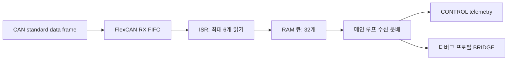

# CAN 송수신과 응답 유효성

[문서 안내](README.md) · [USB 상태 패킷](usb-protocol.ko.md) · [타이밍 진단](timing-diagnostics.md)

소스: [can_control.cpp](../src/can_control.cpp), [can_tx_schedule.hpp](../include/can_tx_schedule.hpp),
[md200t_can.cpp](../src/md200t_can.cpp), [flexcan0.cpp](../src/flexcan0.cpp), [flexcan0.hpp](../include/flexcan0.hpp).

## 버스와 휠 매핑

현재 `can_begin()`은 500 kbit/s만 지원한다. 대상은 Teensy 3.2 / MK20DX256이며,
초기화는 PTA12/PTA13의 MUX=2와 16 MHz OSCERCLK 기반 타이밍을 사용한다.
명령은 standard data frame이며 DLC=8이다.
드라이버 A의 ID는 1, B는 2다. 수신 파서는 MID=7 응답만 일반 제어 telemetry로 해석한다.

| 드라이버 | 명령 ID | 응답 ID | PID196 / CH1 | PID201 / CH2 |
| --- | --- | --- | --- | --- |
| A | `0x001` | `0x701` | LF: 왼쪽 앞 | RR: 오른쪽 뒤 |
| B | `0x002` | `0x702` | RF: 오른쪽 앞 | LR: 왼쪽 뒤 |

| 명령 | 8바이트 data, 숫자는 10진수 | 용도 |
| --- | --- | --- |
| PID207 | `[207, 1, rpm1_lo, rpm1_hi, 1, rpm2_lo, rpm2_hi, 0]` | signed int16 RPM 두 채널 |
| PID174 | `[174, 1, 1, 0, 0, 0, 0, 0]` | TQ-OFF |
| PID4 | `[4, target_pid, 0, 0, 0, 0, 0, 0]` | 지정 PID 조회; 일반 제어는 PID143 전압 조회 |

펌웨어는 PID196/201 자동 응답을 기대하지만 PID149 등 드라이버 응답 설정을 쓰거나 읽어 확인하지 않는다.
장비가 해당 응답을 내도록 설정돼 있는지는 별도 조건이다. CLI의 PID193/200 기본 매칭은
[호스트 도구 문서](can-cli-windows.md)에서 구분한다.

## 일반 제어 스케줄

CONTROL의 목표 주기는 10 ms다. A를 주기 시작에, B를 위상 +3 ms 이후에 전송하되
**실제 A 송신 호출 시점으로부터도 3 ms**를 확보한다. B 다음 전압 조회도 B의 3 ms 창 뒤에 한다.
응답 두 개가 일찍 도착해도 이 송신 간격은 줄이지 않는다.

전압 요청은 100주기 superframe의 cycle 0에서 A, cycle 50에서 B이며, 명목 위상은 +6 ms다.
지연이 없을 때 각 드라이버당 1 Hz다. 전압 요청부터 다음 cycle A까지의 최소 간격은 별도로 보장하지 않는다.
지연된 cycle은 몰아서 재생하지 않으며, 지속적인 루프 지연에서는 B 예약이 밀릴 수 있다.

주기 시작의 B 명령을 보관하되 B 송신 전에 구동 비활성 여부를 다시 확인한다.
비활성 출력은 PID174를 사용한다. POWERDOWN·전원 복귀 대기 중에는 주기 CAN 송신이 없다.
BRIDGE에서는 이 스케줄이 중지된다. BRIDGE 진입·소프트웨어 리셋의 즉시 TQ-OFF 두 건은
일반 응답 창 스케줄 밖에서 시도한다.

## 모터 응답과 전압 판정

PID196/201은 DLC≥8이어야 하며 data[1]=원시 상태, [2..3]=signed RPM,
[4..7]=signed encoder count로 해석한다. 해당 드라이버 명령이 전송됐고 창이 아직 닫히지 않았으며,
송신 직전 시각과 RX 시각의 unsigned 차이가 **3000 µs 미만**이어야 수용한다.
두 응답이 완성되면 창을 완료 처리한다. 응답에 명령 sequence가 없으므로 이 조건만으로
정확히 같은 요청에 대한 응답임을 증명하지는 못한다.

마감 전에는 큐를 최대 32개 처리한 뒤 빠진 휠을 무효화하고 timeout을 보고한다.
이전 유효값을 매 cycle 시작에 전부 지우지 않으므로 `valid`는 반드시 현재 라운드에서 새로 받은 값이라는 뜻이 아니다.
수신 timestamp와 함께 읽어야 한다. 네 휠 완성 시 상태 전송을 요청하고, 미완성이면 B 창 마감이나
cycle 이월에서도 요청한다. `0x82`는 목표 100 Hz이며 USB 여유와 루프 지연에 따라 요청이 합쳐질 수 있다.

PID143은 MID=7, 올바른 driver ID, DLC≥3이며 signed 원시 전압이 1..655인 경우 수용한다.
단위는 0.1 V이며 상태 패킷에는 100을 곱한 mV로 보낸다. 수신 후 3000 ms 이내를 유효하게 본다.
CONTROL 세션 시작 3000 ms 이후 한쪽이라도 유효하지 않으면 stale을 보고한다.
양쪽 모두 유효하고 어느 한쪽이 21000 mV 미만일 때 저전압을 보고한다.

## FIFO → ISR → RAM 큐 → 애플리케이션

RX FIFO는 MB0..5와 필터 영역 MB6..7을 사용하고 TX는 MB8이다. 필터는 모든 standard data ID를
허용하며 자기 송신 수신은 비활성이다. ISR 우선순위는 64다. 각 FIFO pop 후 CAN0_TIMER를 읽는다.
RAM 큐가 차면 새 프레임을 버린다. 메인 루프는 RAM 큐에서 프레임을 가져와 처리한다.

`rx_timestamp_us`는 **ISR이 FIFO 필드를 읽기 직전에 얻은 `micros()`**다. 하드웨어 버스 도착 시각,
드라이버 내부 샘플 시각, 메인 루프 dequeue 시각과 다르다. IRQ 지연과 FIFO 대기는 포함될 수 있고
RAM 큐 대기는 제외된다. `micros()`는 uint32 래핑을 고려해야 한다.

## 진단값과 한계

`CanRxStats`는 FIFO overflow 관측, RAM queue overflow, queue high-water mark,
최대 queue age를 제공한다. 누적 통계와 10회 상태 보고용 overrun 카운터는 용도가 다르다.
FIFO 관측과 queue drop의 합은 정확한 버스 손실 프레임 수가 아니다. 하드웨어 플래그는 사건을
합칠 수 있고 FIFO warning도 곧바로 손실 수를 뜻하지 않는다. 통계 조회는 전체 항목의 동시 스냅샷을 보장하지 않는다.

TX는 완료 대기와 사용 중인 mailbox의 abort 대기에 각각 제한을 둔다. 호출에 전달하는 2 ms를
함수 전체의 절대 실행시간 상한으로 해석하면 안 된다. 코드에는 CODE=9 abort 경로가 있으나
초기화의 AEN 설정과 런타임 ESR1/ECR 진단·CAN 재초기화는 없다. 해당 검토는
[사고 분석 A·D 항목](rc-loss-of-control-review-2026-11-09.ko.md)에 남겼다.
물리 버스·복구 경로의 실물 동작은 소스 설명만으로 확인할 수 없다.
