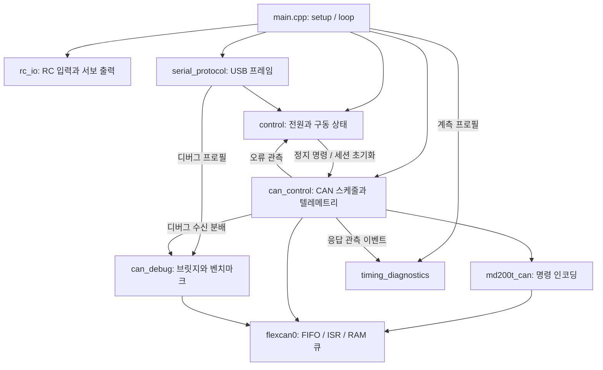

# 펌웨어 구조와 빌드 프로필

[문서 안내](README.md) · [RC 제어](rc-steering.ko.md) · [USB 규격](usb-protocol.ko.md)

현재 펌웨어는 RC MANUAL 전륜 조향·4륜 구동과 후륜 중심 PIVOT 회전을 지원한다. AUTO 구동은 차단하며,
호스트 제어 패킷은 수신·상태 기록과 CONTROL 복귀 목적으로 처리한다.

## 네 프로필

| 환경 | RC 제어 / `0x82` | 브릿지·벤치마크 | 타이밍 `0x84` |
| --- | --- | --- | --- |
| `teensy32_control` (기본) | 포함 | 제외 | 제외 |
| `teensy32_debug` | 포함 | 포함 | 제외 |
| `teensy32_timing` | 포함 | 제외 | 포함 |
| `teensy32_debug_timing` | 포함 | 포함 | 포함 |

프로필의 선택 지점은
[platformio.ini](../platformio.ini)이며 [build_features.hpp](../include/build_features.hpp)가 기능 플래그의 기본값과 허용값을 정의한다.
`build_src_filter`는 비활성 기능의 `.cpp`를 빌드 대상에서 제외한다. 디버그와 타이밍
플래그는 독립적이며, 일반 제어 코드의 사본을 프로필별로 만들지 않는다.

빌드할 환경을 선택하여 해당 명령을 실행한다.

```powershell
pio run -e teensy32_control
pio run -e teensy32_debug
pio run -e teensy32_timing
pio run -e teensy32_debug_timing
```

산출물 경로는 `.pio/build/<환경>/firmware.hex`다. 빌드 명령은 업로드를 포함하지 않는다.
장비에 적용할 때는 산출물의 소스 버전과 환경을 구분한다.

## 모듈과 상태 소유권

| 파일 | 역할과 소유 상태 |
| --- | --- |
| [main.cpp](../src/main.cpp) | 초기화 순서, 한 루프의 처리 순서, 선택 기능 연결 |
| [control.cpp](../src/control.cpp) | 전원·운용 모드, 명령·운동 상태, 오류 반복 보고, 세션 전환과 리셋 |
| [rc_io.cpp](../src/rc_io.cpp) | RC 인터럽트·PWM 필터, 입력 읽기와 서보 PWM 출력 |
| [can_control.cpp](../src/can_control.cpp) | 주기 송신·응답 창, 텔레메트리·유효성, 시스템 상태 송신 요청 |
| [serial_protocol.cpp](../src/serial_protocol.cpp) | 프레임 파서, 제어·리셋 명령 분배, `0x82` 인코딩·송신 sequence |
| [can_debug.cpp](../src/can_debug.cpp) | 디버그 전용 브릿지·벤치마크 상태와 `0xA0`/`0xA1` 인코딩 |
| [timing_diagnostics.cpp](../src/timing_diagnostics.cpp) | 계측 통계·동결 스냅샷·전송 진행 상태와 `0x84` 인코딩 |
| [md200t_can.cpp](../src/md200t_can.cpp) | MD200T 명령 인코딩과 응답 CAN ID 해석 |
| [flexcan0.cpp](../src/flexcan0.cpp) | CAN 하드웨어, FIFO ISR, RAM 수신 큐와 overflow 관측 |

공개 헤더는 대응 모듈의 호출 인터페이스를 정의한다. 변경 가능한 전역변수를
`extern`으로 공유하지 않는다. `control::status()`, `control::motion_output()`,
`can_control::telemetry()`는 읽기 전용 참조다. 이 참조들은 메인 루프 내부의 관측용이며
ISR이나 별도 태스크에 넘길 동시성 보장 스냅샷은 아니다.

운동학·명령 전환은 [vehicle_kinematics.hpp](../include/vehicle_kinematics.hpp)와
[vehicle_motion.hpp](../include/vehicle_motion.hpp)를 사용한다. 실측 서보 PWM 표와 구동 제한은
[steering_config.hpp](../include/steering_config.hpp)에 있다. `control.cpp`는 전원·오류·세션을
함께 관리한다. 일반 USB 패킷 처리는 `serial_protocol.cpp`, 디버그 패킷 처리는 `can_debug.cpp`가
담당한다. 디버그·계측 모듈은 프로필에 따라 빌드에서 제외할 수 있다.

## 실행 흐름



`setup()` 순서는 릴레이 초기화 → USB·계측 초기화 → 서보 중립 출력과 motion 초기화 →
RC 인터럽트 연결 → LED·100 ms 대기 → 세션 초기화 → CAN 초기화 → boot 종료다.

`loop()`의 순서는 다음과 같다.

1. 계측 시작, 현재 시각과 RC 모드 읽기.
2. 전원 상태 처리 후 RC 속도·조향 입력 읽기.
3. USB 명령 처리.
4. 디버그 결과 송신 시도 → CAN 수신 처리 → 디버그 진행·결과 송신 시도.
5. 텔레메트리 freshness → 구동 명령 → 오류 보고 갱신.
6. CAN 주기 송신 → 시스템 상태 송신 → 서보 출력.
7. 계측 출력과 loop 시간 집계.

디버그가 없는 프로필은 4번의 CAN 수신 처리만 수행한다. RC 입력은
모드를 먼저 읽고 전원 처리 후 두 PWM 값을 읽는다. 채널들이 하나의 원자적 스냅샷으로
묶인다고 가정하지 않는다.

CAN 큐의 일반 소비·분배는 `can_control::process_queued_rx()`가 맡는다. 응답 창 마감과
벤치마크 timeout 직전에도 이 경로로 대기 프레임을 처리한다. raw 브릿지 요청은
자신의 요청 처리 중 `can_receive()`로 첫 응답을 기다린다. 모두 메인 문맥에서
순차 실행하며 계측 모듈은 프레임을 소비하지 않는다.

## 프로필별 프로토콜

| 패킷 | control | debug | timing | debug_timing |
| --- | --- | --- | --- | --- |
| 제어 `0x01`, 보호 리셋 `0x02` 수신 | 지원 | 지원 | 지원 | 지원 |
| 시스템 상태 `0x82` | CONTROL에서 송신 | CONTROL에서 송신 | CONTROL에서 송신 | CONTROL에서 송신 |
| 브릿지 `0x20` / `0xA0` | 미지원 | 지원 | 미지원 | 지원 |
| 벤치마크 `0x21` / `0xA1` | 미지원 | 지원 | 미지원 | 지원 |
| 타이밍 `0x84` | 미지원 | 미지원 | CONTROL에서 송신 | CONTROL에서 송신 |

모든 프로필은 CONTROL로 부팅한다. 디버그 프로필은 유효한 브릿지·벤치마크 요청을 받으면
BRIDGE에 진입하며 이때 TQ-OFF를 시도한다. 유효 `0x01` 수신이나 POWERDOWN 전환은
벤치마크를 취소하고 CONTROL로 전환한다. 리셋은 RESETTING 상태로
주기 송신을 막는다. POWERDOWN·드라이버 시작 대기가 아닐 때 TQ-OFF를 시도한 뒤,
전송 성공 여부와 무관하게 MCU 리셋을 수행한다.

디버그가 없는 프로필도 알려진 `0x20`/`0x21` 프레임의 길이만은 인식한다. 전체 프레임을
소비한 뒤 framing 오류로 보고하며, 모드 전환·CAN 송신·`0xA0`/`0xA1` 응답은 하지 않는다.
CLI의 브릿지 명령도 해당 프로필에서 응답하지 않는다. CLI는 펌웨어 프로필을 자동 탐지하지 않는다.

`0x84`는 스냅샷당 22개 레코드를 출력한다. `teensy32_timing`의 benchmark
stage 2/4/5 및 예약된 steering stage 11은 0이다. 디버그 계측은 BRIDGE 중에도 누적하되
CONTROL에서만 출력한다. 계측 출력은 CAN 응답 창 이후 +7..10 ms와 USB 여유 조건을
따른다. POWERDOWN·드라이버 시작 대기에는 응답 창 위상 조건을 생략한다.
패킷 최소 간격은 20 ms, 스냅샷 최소 간격은 1초이며 통계는 누적된다. 세부 의미와
출력 지연은 [타이밍 진단](timing-diagnostics.md)에 정리했다.

## 설정과 상수의 위치

- RC 핀·필터·모드 경계: `rc_io.cpp`, 입력 변환 단위: `rc_io.hpp`.
- 릴레이·드라이버 시작 대기·명령 timeout·리셋 레지스터: `control.cpp`; setup I/O 대기: `main.cpp`.
- CAN 주기·응답 창: `can_tx_schedule.hpp`; 전압 기준과 진단 송신 위상: `can_control.cpp`.
- 패킷 필드: `serial_protocol.hpp`, 디버그·계측 전용 필드는 해당 `.cpp` 내부.
- 수치 허용오차·바퀴 인덱스·단위 변환: 운동학·motion·조향 헤더.

## RC 구동 경로

`control.hpp`는 RC 모드를 정의하며, `rc_io.cpp`가 필터링된 모드 PWM을 해석한다.
`control.cpp`는 MANUAL에서 선속도·곡률 명령을, PIVOT에서 후륜 중심 각속도 명령을 생성한다.
두 경로 모두 `vehicle_kinematics.hpp`의 휠 목표 계산과 `vehicle_motion.hpp`의 모션 전환을 사용한다.
최대 PIVOT 요청 각속도는 `steering_config.hpp`의 `rc_pivot_maximum_angular_velocity`다.

MANUAL/PIVOT은 네 프로필의 CONTROL 경로에 공통으로 포함된다. 두 모드의 CAN 명령·응답과
USB 상태 패킷 형식은 동일하다. PIVOT의 즉시 고정 조향 지령과 RPM 전환 조건은
[RC 제어](rc-steering.ko.md)를 참고한다.
